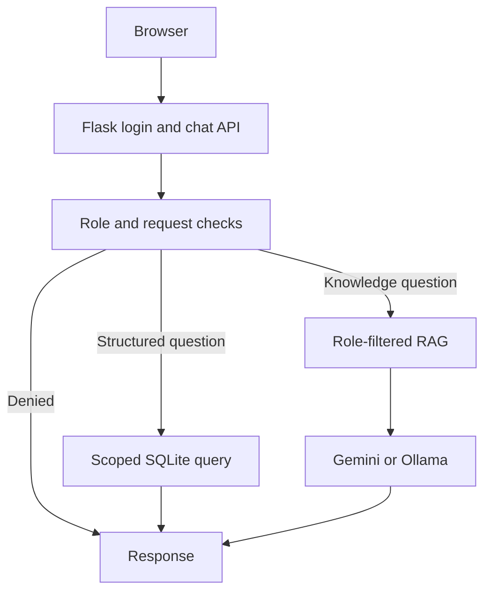

# SLT AI Assistant

A role-based telecommunications knowledge assistant prototype using Flask, SQLite, keyword-based retrieval-augmented generation (RAG), and Google Gemini (or local Ollama). This is an educational demonstration, not an official SLT service. All generated records and example policies are synthetic.

## Live Demo

[](https://sltassistant.duckdns.org/)

**Try the deployed project:** [https://sltassistant.duckdns.org/](https://sltassistant.duckdns.org/)

The prototype is hosted on AWS EC2 and accessible over HTTPS. The login page supports Customer, Staff and Administrator demo accounts. Contact the project owner for authorised demo access; passwords are not published in this repository.

## Features

- Customer: own account, subscriptions, package prices, bills and troubleshooting.
- Staff: assigned tickets and authorised support procedures.
- Administrator: aggregate counts, package distribution and support statistics.
- Session authentication, password hashing, CSRF protection and role-filtered retrieval.
- Read-only chat operations; direct SQL answers for supported structured questions.

## Architecture



## Run locally (Python 3.10+)

Clone or extract the repository, then open a terminal in the directory containing `app.py`.

```sh
python -m venv .venv
```

Activate on Windows PowerShell: `.\.venv\Scripts\Activate.ps1` (or use `.venv\Scripts\python.exe` directly). On Linux/macOS: `source .venv/bin/activate`.

```sh
python -m pip install -r requirements.txt
```

Copy `.env.example` to `.env` (PowerShell: `Copy-Item .env.example .env`; Linux/macOS: `cp .env.example .env`). Generate a unique secret:

```sh
python -c "import secrets; print(secrets.token_hex(32))"
```

Put that value in `FLASK_SECRET_KEY` in `.env`. Set `GEMINI_API_KEY` to your own Google AI Studio key and `GEMINI_MODEL` to a model available to your account. Never commit `.env`. Direct database answers do not need an AI key. Alternatively install Ollama, run `ollama pull qwen2.5:1.5b`, start Ollama and set `AI_PROVIDER=ollama`.

### First-time database setup

Run these commands only for a new database, in this order:

```sh
python generate_data.py
python seed_knowledge.py
python create_demo_users.py
python app.py
```

Open http://localhost:5000. The user creation command prints newly generated random passwords for `customer_demo`, `staff_demo`, and `admin_demo`. Save them privately. Existing users are not reset. Optional `DEMO_CUSTOMER_PASSWORD`, `DEMO_STAFF_PASSWORD`, `DEMO_ADMIN_PASSWORD` environment variables can specify initial passwords.

The data generator refuses to overwrite an existing database. Do not run it against a live deployment. The generated dataset contains 1,000 customers, 20 packages, 1,500 subscriptions, 6,000 bills, 2,500 tickets and 150 staff records.

## Files

| File | Purpose |
|---|---|
| app.py | Flask routes, login, sessions, CSRF and chat |
| database.py | SQLite schema and connections |
| business_data.py | Scoped SQL queries |
| business_router.py | Question routing and direct answers |
| role_safety.py | Request restrictions |
| rag.py | Keyword retrieval with role filtering |
| ai_engine.py | Gemini/Ollama integration |
| generate_data.py | Fresh synthetic dataset |
| seed_knowledge.py | Demo knowledge documents |
| create_demo_users.py | Demo accounts |
| templates/ and static/ | Web UI |
| tests/ | Offline regression checks |

## Testing

After installing dependencies, run `python -m unittest discover -s tests -v`. Tests use a temporary database and do not call Gemini. The original `test_*.py` scripts are retained as exploratory scripts; some require a configured AI provider or database. This reconstructed release was syntax-checked; full Flask and live AI validation must be performed after installing dependencies.

## AWS deployment (new server)

On Ubuntu, install Python, venv and Nginx. Copy the project to a dedicated application directory, create a virtual environment and install requirements. Configure `.env` with an absolute DATABASE_PATH, unique secret and your API key. Initialise only a new database as described above. Run Gunicorn as an unprivileged service user, for example `gunicorn --bind 127.0.0.1:8000 --timeout 120 app:app`. Configure systemd to use the project working directory and virtual environment. Configure Nginx to proxy to localhost:8000, enable HTTPS with a valid certificate and set `FLASK_HTTPS=true` after HTTPS works. Allow only necessary inbound ports (SSH restricted to your IP, HTTP/HTTPS); do not expose Gunicorn directly.

For an existing deployment, back up the SQLite database using SQLite's backup API and back up source files and `.env` privately. Test the new release in a separate directory with a database copy first. Do not replace `.env`, the database or password hashes, and do not run `generate_data.py` on an existing deployment. Seed knowledge only after reviewing the changes.

## Security and limitations

This prototype uses keyword routing and request filters, not comprehensive security enforcement for arbitrary prompts. Do not use real customer data without a security/privacy review. AI context may be sent to Google when Gemini is selected. Demo procedures are not verified official policies. The assistant cannot execute arbitrary SQL or perform financial transactions. The source was reconstructed from the original uploaded project; it is not a verified export of the live EC2 server.
